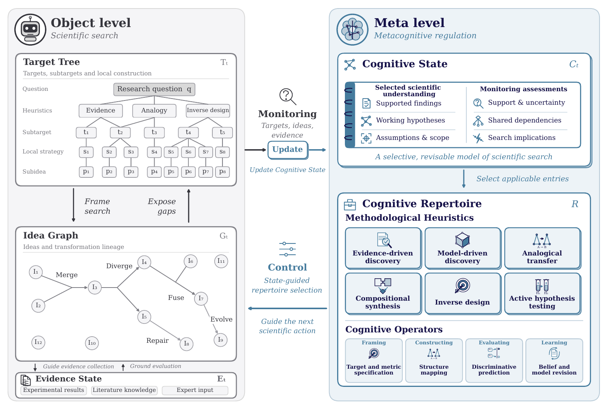
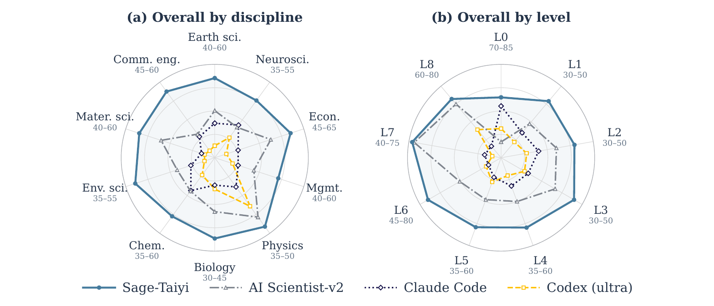

# Sage-Taiyi: A Metacognitive Architecture for Scientific Discovery

**Sage-Taiyi** uses what it learns during a study to decide what to investigate next and how to investigate it. Its metacognitive-inspired architecture revises working hypotheses and assumptions as evidence accumulates, then uses those revisions to guide the next research action.

- **[Adaptive scientific search](#how-sage-taiyi-works).** Monitoring tracks what the evidence supports and what remains uncertain. Control uses those assessments to adjust research targets and choose reasoning methods.
- **[Scientific ideation](#taiyi-bench).** Sage-Taiyi ranked first on all eight Taiyi-Bench metrics among the evaluated configurations. The technical report also presents results on two external ideation benchmarks.
- **[Expert-guided validation](#research-collaborations).** Five collaborations took proposals into experiments and simulations. In two chemistry studies, condition optimization raised model-reaction yields from trace amounts to **84%** and from **13% to 69%**.

  
  

*Figure 2 from the technical report. Monitoring carries evidence from scientific search into the Cognitive State. Control uses that state to select methods for the next research action.*

## How Sage-Taiyi works

- **Scientific search.** The Target Tree breaks a research question into subtargets, the Idea Graph tracks how proposed ideas branch and change, and the Evidence State records results from experiments, literature, and expert input.
- **Metacognitive regulation.** Monitoring revises the Cognitive State, including supported findings, working hypotheses, and their limits. Control uses that state to select heuristics and operators from the Cognitive Repertoire.

## Taiyi-Bench

Taiyi-Bench uses **265 tasks from 50 papers across 10 disciplines** to test whether a system can recover scientific decisions from published studies and propose viable alternatives. Tasks vary how much of the original study is disclosed.

Sage-Taiyi scored **53.95/100** overall, compared with **47.85/100** for AI Scientist-v2, the strongest baseline. It ranked first on all eight rediscovery and open-ended ideation metrics among the configurations evaluated in the report.

*Figure 9 from the technical report. Overall scores by discipline and by information level. Each axis shows its own score range.*

## Research collaborations

Five expert-guided collaborations took Sage-Taiyi's proposals into wet-lab experiments or engineering simulations.

| Study | Reported outcome |
| --- | --- |
| Cobalt-catalysed carbonylation | Model-reaction yield rose from trace amounts to **84%** after condition optimization. |
| Photocatalytic allylic amination | Model-reaction yield rose from **13% to 69%** after condition optimization. |
| Electromagnetic metamaterials | Simulated average transmission reached **6.2% in the stopband** and **94.5% in the passband**. |
| Cast magnesium alloy | The alloy reached a mean measured tensile strength of **342 MPa** across repeated tests. |
| Centrifugal compressor | The optimized design reached **91.5% simulated impeller efficiency** at a pressure ratio of **4.0**. |

## Related Projects

- [**Sage-A1.5**](https://github.com/Alpha-Innovator/Sage-A1.5), a 35B agentic model for engineering tasks, long-horizon search, and scientific research.
